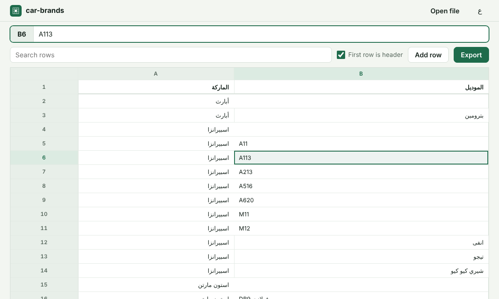

# Excel Table

Open, edit and convert spreadsheets in your browser. **xlsx, csv, tsv and json in; xlsx, csv and json out.**
No server, no build step, no dependencies, and nothing is uploaded: your file never leaves your device.

<p>
  
  
</p>


## What it does

- **Open** `.xlsx`, `.csv`, `.tsv` and `.json` files (choose a file, or drop it anywhere on the page). Multi-sheet workbooks get tabs.
- **Edit** like a spreadsheet: tap a cell, change it in the formula bar at the top, press Enter. Add, insert and delete rows and columns (deletes can be undone).
- **Search** all rows and **sort** by any column (tap the column letter).
- **Export** the whole workbook to `.xlsx`, or the current sheet to `.csv` or `.json`.
- **Mobile first.** Big touch targets, a bottom sheet for menus and sticky headers.
- **English and Arabic**, with a right-to-left layout. Arabic CSV files saved by Excel (windows-1256) open correctly, and an exported `.xlsx` is set to right-to-left automatically when its content is Arabic.
- **Light and dark** theme, following the device setting.

## Use it

**Online:** after you publish it (see below) it lives at `https://YOUR-USERNAME.github.io/YOUR-REPO/`.

**Locally:** clone the repository and open `index.html` in a browser. That is all, it also works from `file://`.
If you prefer a local server: `npm start` (needs Node 18 or newer) and open <http://localhost:8080>.

## Publish on GitHub Pages

1. Create a repository on GitHub and push this folder to it (commands below).
2. On GitHub open **Settings > Pages**.
3. Under **Build and deployment**, choose **Deploy from a branch**, branch `main`, folder `/ (root)`, then Save.
4. After a minute the site is live at `https://YOUR-USERNAME.github.io/YOUR-REPO/`.

```bash
git init -b main
git add .
git commit -m "Add Excel Table"
git remote add origin https://github.com/YOUR-USERNAME/YOUR-REPO.git
git push -u origin main
```

## Project layout

```
index.html        the page
css/style.css     mobile-first styles (light and dark)
js/zip.js         zip reader and writer (uses the browser's built-in deflate)
js/xlsx.js        .xlsx reader and writer
js/tabular.js     csv and json import and export
js/values.js      cell values: formatting, parsing, sorting
js/i18n.js        English and Arabic strings
js/app.js         the user interface
data/sample.js    sample data (car brands and models)
tests/            automated tests and example .xlsx files
```

The scripts are plain `<script>` files rather than ES modules on purpose, so the page also opens by double-clicking `index.html`.

## Tests

```bash
npm test      # Node 18 or newer, no install needed
```

The tests read real `.xlsx` files made by Excel-compatible programs (openpyxl, xlsxwriter and LibreOffice, in `tests/fixtures`)
and check that files written by this project round-trip. `tests/fixtures/make_fixtures.py` regenerates the fixtures.

## Limits

- **Old `.xls` files are not supported.** Open them in Excel and save as `.xlsx`.
- Formatting (colors, fonts, merged cells), charts, images and macros are not kept. Formulas are read as their last calculated value, and they are exported as values.
- Numbers show as stored, so a cell formatted as `25%` shows `0.25`. Dates and times show as `2024-03-05` or `2024-03-05 13:45`.
- Text that looks like a number is turned into a number when you type it or open a CSV, except values with leading zeros or more than 15 digits (`00123`, phone numbers), which stay text.
- Files up to 100 MB are accepted, but very large sheets use a lot of memory on a phone. Rows are shown 100 per page.
- Sorting and searching change the view only. Exports keep the original row order.

## بالعربي

افتح ملف إكسل أو CSV أو JSON، وعدّل الخلايا، ثم صدّره بصيغة xlsx أو csv أو json. كل شيء يعمل داخل المتصفح ولا يُرفع أي ملف.
لتشغيله: افتح `index.html`. وللنشر على GitHub Pages اتبع خطوات «Publish on GitHub Pages» أعلاه.

## License

[MIT](LICENSE)
